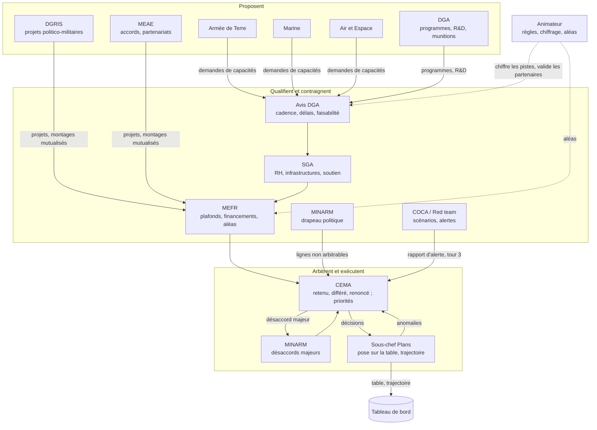

# STRATEGIKON : les acteurs, leurs prérogatives et leur interface

Document de conception, sans effet sur l'outil en ligne. Il s'appuie sur les 13 fiches de rôle en français du Drive (corpus Strategikon) et sur l'ambition présidentielle 2027-2033. Les pages citées sont celles des PDF d'origine.

On compte 13 acteurs : 12 rôles joueurs et l'animateur. La COCA et la Red team sont la même fiche en deux versions, l'une conduite par le MEAE, l'autre par la DGRIS.

## 1. Cinq familles de contribution

| Famille | Acteurs | Ce qu'ils apportent |
|---|---|---|
| **Proposer des capacités** | Armée de Terre (EMAT), Marine (EMM), Armée de l'Air et de l'Espace (EMAAE) | Des pions capacité, des DORESE, de nouvelles tuiles |
| **Proposer des programmes, de la R&D et des contraintes industrielles** | DGA | Fiches programme chiffrées, R&D, munitions ; avis industriel sur toutes les demandes d'armement |
| **Proposer des projets politico-militaires** | DGRIS, MEAE | Présence avancée, partenariats, brigades multinationales, montages de coopération |
| **Qualifier et contraindre** | MINARM (politique), MEFR (budget), SGA (RH, infrastructures, soutien), COCA / Red team (cohérence face aux scénarios) | Drapeaux, plafonds, surcoûts, alertes, mais aussi quelques dépenses propres (MEFR, SGA) |
| **Arbitrer et exécuter** | CEMA (arbitre militaire), Sous-chef Plans (seul à poser les pions), MINARM (arbitre politique en dernier ressort), animateur (règles et aléas) | Décisions retenu, différé, renoncé ; placement sur la table ; aléas |

Le MINARM appartient aux deux dernières familles : il qualifie le politique avec le drapeau tricolore et tranche les désaccords majeurs.

## 2. Fiche par acteur

### Armée de Terre (EMAT)

- **Nature** : propose des capacités.
- **Prérogatives** :
  - exprimer les besoins capacitaires (Scorpion, Leclerc XLR, MGCS, CIFS, sol-air, drones) (Terre p2) ;
  - définir les tuiles Terre, interarmées ou infrastructure, et les DORESE nécessaires (p3) ;
  - appliquer le doublement des DORESE en haute intensité (p2-3) ;
  - créer des tuiles personnalisées, à condition de les justifier (p6).
- **Dans l'outil** :
  - créer des pions Terre et renforcer ses capacités à 100 % ;
  - proposer une priorité de P1 à P4 sur ses lignes ;
  - demander une contrainte politique, sans pouvoir la cocher ;
  - commenter.
- **Interactions obligatoires** : les autres armées pour la mutualisation et l'interopérabilité (p3). Il consulte la DGA, le SGA, le CEMA et le MINARM pour chiffrer (p4).

### Marine nationale (EMM)

- **Nature** : propose des capacités.
- **Prérogatives** :
  - défendre SNLE 3G, Suffren, PA-NG, FREMM, FDI, PHA, MdCN (Marine p2) ;
  - identifier les investissements, escortes et infrastructures du PANG (p4) ;
  - proposer un second porte-avions, avec un calendrier imposé sur 5 ans (p5) ;
  - évaluer les stocks de munitions navales (p8) ;
  - créer des tuiles personnalisées (p8).
- **Dans l'outil** : comme l'EMAT, mais sur le plateau Marine.
- **Interactions obligatoires** : la DGA, le CEMA, le MINARM et le SGA pour chiffrer (p5). L'IA navale doit être validée par le CEMA (p6).

### Armée de l'Air et de l'Espace (EMAAE)

- **Nature** : propose des capacités.
- **Prérogatives** :
  - défendre la dissuasion aéroportée, le Rafale F5/F6 ou le SCAF, l'ISR, le sol-air et l'espace (Air p2) ;
  - piloter la transition Rafale/SCAF et le choix sur les C-130H (p2-3) ;
  - créer des tuiles personnalisées (p6).
- **Dans l'outil** : comme l'EMAT, mais sur le plateau Air et Espace.
- **Interactions obligatoires** : Terre, Marine, DGA et CEMA pour l'interopérabilité (p2). DGA, SGA, MINARM et CEMA pour chiffrer (p4).

### DGA

- **Nature** : propose des programmes et de la R&D, et contraint sur le plan industriel.
- **Prérogatives** :
  - programmer les demandes d'acquisition des armées (DGA p2) ;
  - veiller à ce qu'une commande ne varie pas de plus de 25 % par an ;
  - imposer un report, une mutualisation ou un glissement ;
  - refuser une tuile ou proposer une alternative (achat sur étagère, prolongation, cofinancement) (p2) ;
  - exiger 3 ans de préavis et des commandes minimales pour une nouvelle chaîne de production (p3) ;
  - ouvrir une négociation directe avec le MEFR ou le MEAE (p3) ;
  - garantir les stocks de munitions (p6, p11).
- **Dans l'outil** :
  - créer des pions programme, R&D et munitions ;
  - donner un **avis DGA** sur toute ligne d'armement (favorable, report, mutualisation, alternative, refus) ;
  - gérer son enveloppe R&D ;
  - proposer un montage de financement ;
  - commenter.
- **Interactions obligatoires** : les armées (besoins), le MEFR (budget) et le MEAE (coopérations) (p2-3).

### DGRIS

- **Nature** : propose des projets politico-militaires et qualifie la pertinence stratégique.
- **Prérogatives** :
  - interroger la pertinence stratégique du modèle sans le construire (DGRIS p2) ;
  - proposer ou négocier la présence avancée (Roumanie, Pologne, Baltique, Djibouti, Indo-Pacifique), les brigades multinationales et le soutien aux programmes européens (p6, p8) ;
  - exiger des partenaires identifiés et une part française explicite (p2-3) ;
  - pour chaque engagement, préciser l'intérêt, les moyens, les contributions alliées, la réversibilité et le coût d'opportunité (p2-3).
  - Les initiatives qui supposent une décision extérieure au ministère passent par les facilitateurs (p7).
  - La DGRIS conduit la Red team (Red team p3).
- **Dans l'outil** :
  - créer des options du catalogue DGRIS ;
  - proposer un montage mutualisé avec ses partenaires ;
  - remplir la fiche d'engagement ;
  - proposer un changement de priorité, que le CEMA accepte ou non ;
  - commenter.
- **Interactions obligatoires** : CEMA, MINARM, SGA, DGA, MEFR et armées (p7).

### MEAE

- **Nature** : propose des projets diplomatiques et construit le cadre international.
- **Prérogatives** :
  - garantir partenaires, accords, implantations et légitimité (MEAE p2) ;
  - mêmes options que la DGRIS (p4, p6) ;
  - leviers de coopération industrielle, militaire et stratégique : transit, soutien nation hôte, bases (p4-5).
  - Le MEAE conduit l'équipe COCA (COCA p3).
- **Dans l'outil** : comme la DGRIS ; il valide en plus la **plausibilité diplomatique** d'un partenaire, avec l'animateur.
- **Interactions obligatoires** : CEMA, MINARM, SGA, DGA, MEFR (qui valide les coûts) et armées (p5).

### MEFR

- **Nature** : qualifie et contraint le budget ; il propose aussi des leviers de financement.
- **Prérogatives** :
  - autoriser, ajuster ou suspendre des programmes (MEFR p2) ;
  - imposer redéploiements, reports ou révisions (p2) ;
  - ajuster la trajectoire budgétaire (p4-5) ;
  - provisionner les surcoûts carburants et l'inflation (p5) ;
  - lever la clause OPEX jusqu'à 50 % (p6) ;
  - chercher des financements européens, validés par les facilitateurs (p6) ;
  - imposer une clause de révision ou une réserve stratégique (p6).
- **Dans l'outil** :
  - régler les plafonds annuels ;
  - poser les provisions et les aléas budgétaires ;
  - **valider un financement** (subvention, prêt, part OPEX) ;
  - suspendre une ligne ;
  - commenter.
- **Interactions obligatoires** : DGA, MEAE et MINARM pour les financements européens (p6).

### SGA

- **Nature** : qualifie et contraint (RH, infrastructures, soutien) ; il a aussi des dépenses propres.
- **Prérogatives** :
  - valider les effectifs, avec un plafond de 4 pions masse salariale par an (SGA p2-3) ;
  - planifier les infrastructures, qui doivent accompagner toute implantation (p2) ;
  - gérer les lignes jeunesse et Plan Famille, le développement durable, le SMV et les réserves (p3-8) ;
  - dépasser le plafond RH par des mesures chiffrées (p5) ;
  - déclarer qu'une capacité n'est pas soutenable (p5).
- **Dans l'outil** :
  - créer des options SGA ;
  - **valider ou refuser l'impact RH et infrastructure** d'une ligne ;
  - accorder une dérogation au plafond RH ;
  - marquer une ligne « non soutenable » ;
  - commenter.
- **Interactions obligatoires** : MEFR, MINARM et CEMA pour tout dépassement (p5) ; le CEMA pour l'énergie (p4) ; le SC-Plans, qui applique le plafond RH (p3).

### MINARM (cabinet du ministre)

- **Nature** : qualifie le politique et arbitre en dernier ressort.
- **Prérogatives** :
  - trancher les désaccords majeurs, en lien avec le CEMA (MINARM p5) ;
  - valider ou ajuster toute évolution majeure des forces ou tout programme d'armement (p5) ;
  - imposer priorités et compromis, et orienter la trajectoire (p4-5) ;
  - assurer la cohérence interministérielle avec le MEFR et le MEAE (p5).
- **Dans l'outil** :
  - **cocher le drapeau tricolore** (contrainte politique : ligne non arbitrable, placée au-dessus de la ligne de flottaison) ;
  - lever un blocage ou un passage en force ;
  - arbitrer un désaccord renvoyé par le CEMA ;
  - commenter.
- **Interactions obligatoires** : CEMA, SC-Plans, DGA, SGA, MEAE et MEFR (p5).

### CEMA

- **Nature** : arbitre militaire et garant de la cohérence interarmées.
- **Prérogatives** :
  - proposer le modèle d'armée 2033 et la trajectoire pour l'atteindre (CEMA p3) ;
  - avoir le dernier mot sur tout ce qui dépasse une seule armée (p5) ;
  - demander la mutualisation, la fusion ou la réorientation d'un projet (p4-5) ;
  - convoquer la COCA (COCA p3) ;
  - acter les destructions de capacité en COCEM (SC-Plans p3).
- **Dans l'outil** :
  - **arbitrer** chaque ligne : retenu, différé, renoncé ;
  - modifier la priorité, la valeur du pôle étant conservée ;
  - accepter ou refuser les propositions des autres pôles ;
  - fusionner des lignes ;
  - commenter.
- **Interactions obligatoires** : les armées, la DGA, le SGA, le MEFR (p3), le MINARM et le SC-Plans.

### Sous-chef Plans (SC-Plans)

- **Nature** : exécute la planification et en contrôle la cohérence.
- **Prérogatives** :
  - seul à placer, déplacer, activer ou dégrader les pions (SC-Plans p2-3) ;
  - contrôler les DORESE et l'opérationnalité (face verte ou rouge) (p3) ;
  - imposer 3 ans pour activer une capacité et 2 à 3 ans pour la retirer (p2) ;
  - appliquer le plafond RH (SGA p3) ;
  - signaler les anomalies et saisir le CEMA (p2, p4) ;
  - jouer le battle captain (gestion du temps) et rendre compte au CEMA (p4).
- **Dans l'outil** :
  - **poser les pions retenus sur la table** ;
  - étaler la trajectoire par année ;
  - lever une alerte d'anomalie ;
  - produire les rapports d'avancement ;
  - commenter.
- **Interactions obligatoires** : tous les pôles du ministère et le CEMA ; il coordonne la COCA avec le CEMA (p4).

### COCA / Red team

- **Nature** : qualifie la cohérence face aux scénarios. C'est une « double casquette » de joueurs qui gardent leur rôle principal : MEAE (chef d'équipe), MEFR, MINARM, SGA dans la version COCA ; DGRIS (chef d'équipe), MEFR, MINARM, SGA dans la version Red team (COCA p3, Red team p3).
- **Prérogatives** :
  - convoquée au milieu du tour 3 ;
  - bâtir 6 à 8 scénarios et les évaluer Satisfaisant, Partiel ou Insuffisant (p3) ;
  - remettre un rapport d'alerte au SC-Plans et au CEMA (p2) ;
  - ce rapport peut créer une urgence, annuler ou requalifier une tuile, justifier un renoncement assumé ou alerter l'exécutif (p4).
- **Dans l'outil** :
  - remplir la **grille des scénarios** ;
  - marquer une ligne « urgence COCA » ou « renoncement assumé » ;
  - publier le rapport ;
  - commenter.
- **Interactions obligatoires** : le CEMA (convocation) et le SC-Plans (intégration du rapport).

### Animateur

- **Nature** : applique les règles et déclenche les aléas.
- **Prérogatives** : arbitrer coûts, volumes et délais des pions sur mesure (Terre p6, Air p6, Marine p8) ; valider ce qui suppose une décision extérieure au ministère (DGRIS p7, MEFR p6) ; fixer les plafonds ; poser les pions orange.
- **Dans l'outil** : tous les droits. En plus :
  - **chiffrer une piste** proposée par un rôle ;
  - valider la plausibilité d'un partenaire ;
  - déclencher les aléas (défection alliée, inflation, scénario carburant, haute intensité) ;
  - cocher le drapeau tricolore ;
  - gérer la partie.

## 3. Organigramme des flux

Dans les faits, les avis DGA, SGA et MEFR peuvent être donnés en parallèle, pas forcément l'un après l'autre. Le schéma montre l'ordre logique : faisabilité industrielle, puis soutenabilité, puis coût.

## 4. Matrice rôles × actions

● = droit propre ; ○ = peut demander ou proposer, quelqu'un d'autre décide ; vide = non.

| Action | Terre | Marine | Air | DGA | DGRIS | MEAE | MEFR | SGA | MINARM | CEMA | SC-Plans | COCA | Animateur |
|---|---|---|---|---|---|---|---|---|---|---|---|---|---|
| Créer une demande (pion, option) | ● | ● | ● | ● | ● | ● | ● | ● | | | | | ● |
| Renforcer une capacité (DORESE) | ● | ● | ● | | | | | | | ○ | | | ● |
| Pion sur mesure (piste à chiffrer) | ● | ● | ● | ● | ● | ● | | ● | | | | | ● |
| Fixer la priorité de sa demande | ● | ● | ● | ● | ● | ● | ● | ● | | | | | |
| Proposer une priorité pour un autre | ○ | ○ | ○ | ○ | ○ | ○ | ○ | ○ | ○ | | ○ | ○ | |
| Modifier une priorité | | | | | | | | | | ● | | | ● |
| Cocher le drapeau politique | ○ | ○ | ○ | ○ | ○ | ○ | ○ | ○ | ● | ○ | | | ● |
| Avis industriel | | | | ● | | | | | | | | | |
| Avis RH, infrastructure ; dérogation RH | | | | | | | | ● | | | | | ● |
| Proposer un montage de financement | | | | ● | ● | ● | ● | | | | | | |
| Valider un financement | | | | | | | ● | | | | | | ● |
| Valider la plausibilité d'un partenaire | | | | | | ○ | | | | | | | ● |
| Régler plafonds, provisions | | | | | | | ● | | | | | | ● |
| Suspendre une ligne | | | | | | | ● | | ● | | | | ● |
| Arbitrer (retenu, différé, renoncé) | | | | | | | | | | ● | | | ● |
| Fusionner des lignes | | | | | | | | | | ● | | | ● |
| Trancher un désaccord majeur | | | | | | | | | ● | | | | |
| Poser les pions sur la table | | | | | | | | | | | ● | | ● |
| Signaler une anomalie | ○ | ○ | ○ | ○ | ○ | ○ | ○ | ○ | ○ | ● | ● | ● | ● |
| Grille de scénarios, rapport d'alerte | | | | | | | | | | | | ● | |
| Déclencher un aléa | | | | | | | | | | | | | ● |
| Commenter | ● | ● | ● | ● | ● | ● | ● | ● | ● | ● | ● | ● | ● |
| Voir le tableau de bord | ● | ● | ● | ● | ● | ● | ● | ● | ● | ● | ● | ● | ● |

Les joueurs de la COCA héritent de ces droits COCA en plus de ceux de leur rôle principal, pendant le tour 3 seulement.

## 5. Interface de chaque rôle

Un socle commun à tous les rôles :
- la table de l'année, filtrable sur « Ma demande » ;
- le fil des commentaires ;
- le tableau de bord en lecture.

Chaque rôle voit ensuite un volet qui lui est propre.

### Armées (Terre, Marine, Air)

- **Bandeau** : ma part de la table, mes demandes en attente, mon taux de P1 retenues.
- **Volet principal « Ma demande »** :
  - catalogue de mes pions et de mes options ;
  - boutons Renforcer, Créer, Dissoudre ;
  - priorité P1 à P4 ;
  - bouton « Demander une contrainte politique » ;
  - pion sur mesure avec un champ obligatoire « objectif doctrinal ».
- **Alertes visibles** : délais de mise en service, DORESE manquantes, plafond RH, doublement en haute intensité (Terre).
- **Spécifique Marine** : un assistant « second porte-avions » qui pose les 5 annuités et vérifie le quai.

### DGA

- **Bandeau** : enveloppe R&D (consommée et restante), lignes d'armement en attente d'avis.
- **Volet « Avis industriel »** : file des lignes d'armement de toutes les armées, avec le contrôle automatique de la cadence (±25 %), des commandes minimales et des dates. Pour chaque ligne : favorable, report, mutualisation, alternative ou refus, avec un motif.
- **Volet « Mes programmes »** : fiches programme, R&D (délai selon le niveau de financement), stocks de munitions face au besoin de 30 jours.

### DGRIS et MEAE

- **Bandeau** : projets déposés, retenus, abandonnés ; montant dépendant d'un allié.
- **Volet « Projets »** :
  - options du catalogue (présence avancée, brigades, programmes européens) ;
  - fiche d'engagement obligatoire : intérêt, moyens, part alliée, réversibilité, coût d'opportunité ;
  - montage mutualisé (partenaires, part française).
- **Carte simple des théâtres** (flanc Est, Golfe, Afrique, Indo-Pacifique) avec les projets posés.
- **Spécifique MEAE** : un bouton « partenaire plausible » à confirmer par l'animateur.

### MEFR

- **Bandeau** : plafond, total demandé et marge par année.
- **Volet « Trajectoire »** :
  - réglage des plafonds annuels ;
  - scénario carburants ;
  - aléas d'inflation (proposés à l'animateur) ;
  - réserve stratégique.
- **Volet « Financements »** :
  - file des montages à valider (mutualisé, subvention, prêt et ses remboursements) ;
  - clause OPEX à 50 %.
- **Action** : « Suspendre » sur n'importe quelle ligne.

### SGA

- **Bandeau** : DORESE RH posées dans l'année face au plafond de 4, et lignes protégées (jeunesse, Plan Famille).
- **Volet « Soutenabilité »** :
  - file des lignes qui ont un impact RH ou infrastructure, à valider ou refuser ;
  - marque « non soutenable » ;
  - dérogation RH chiffrée.
- **Volet « Mes options »** : SMV, réserves, infrastructures du flanc Est, ports, dépôts, énergie (avec l'économie de carburant calculée).

### MINARM

- **Bandeau** : drapeaux politiques posés et tenus, couverture des 22 exigences présidentielles.
- **Volet « Politique »** :
  - demandes de drapeau tricolore en attente : accepter ou refuser ;
  - liste des lignes marquées ;
  - désaccords renvoyés par le CEMA, à trancher ;
  - passages en force à valider.
- **Vue de synthèse** : ce que le politique a demandé et ce que le modèle retenu en couvre.

### CEMA

- **Bandeau** : dépassement par année, demandes en attente, alertes ouvertes.
- **Volet « Arbitrage »** :
  - pile des demandes de P1 à P4 avec la **ligne de flottaison**, les drapeaux tricolores en tête ;
  - pour chaque ligne : retenu, différé ou renoncé, priorité modifiable, avis DGA, SGA et MEFR visibles d'un coup d'œil ;
  - propositions des autres pôles à accepter ou refuser ;
  - action « fusionner ».
- **Actions** : renvoyer un désaccord au MINARM, convoquer la COCA.

### Sous-chef Plans

- **Bandeau** : décisions du CEMA à exécuter, anomalies détectées, temps restant du tour.
- **Volet « Table »** :
  - pose des pions retenus ;
  - DORESE au contact ;
  - étalement année par année (avec les délais : 3 ans pour activer, 2 à 3 ans pour retirer) ;
  - glissement de ce qui déborde.
- **Volet « Contrôle »** : anomalies (DORESE manquantes, plafond RH, incohérences), rapport d'avancement pour le CEMA.

### COCA / Red team (tour 3)

- **Bandeau** : scénarios évalués et alertes émises.
- **Volet « Scénarios »** :
  - grille des 6 à 8 scénarios (menace, théâtre, capacités nécessaires, évaluation S/P/I, écart, recommandation) ;
  - lien vers les lignes concernées ;
  - marques « urgence COCA » et « renoncement assumé ».
- **Action** : publier le rapport d'alerte au CEMA et au SC-Plans.

### Animateur

- **Volet « Partie »** : rôles connectés, tours, plafonds.
- **Volet « À trancher »** :
  - pistes à chiffrer ;
  - partenaires à valider ;
  - décisions extérieures au ministère.
- **Volet « Aléas »** : défection alliée, inflation, carburants, haute intensité, pions orange.
- **Droit** : il peut tout faire, et chaque action qu'il fait est tracée dans le journal.

## 6. Décisions

Validé par artus le 25/11 à 6 h 47 : la cartographie, la matrice, les interfaces et les propositions ci-dessous. Avis DGA, SGA et MEFR donnés en parallèle ; un passage en force du CEMA est permis et tracé pour le MINARM ; MEFR et SGA ont deux volets. Reste ouvert : version COCA ou Red team.

## 7. Points qui étaient à trancher

1. **COCA ou Red team** : quelle version joue-t-on ? Le chef d'équipe change, MEAE ou DGRIS.
2. **Ordre des avis** : en parallèle ou en séquence (DGA, puis SGA, puis MEFR) ? Le parallèle est plus rapide en séance.
3. **Les avis bloquent-ils l'arbitrage ?** Le CEMA peut-il retenir une ligne refusée par la DGA ou le SGA ? Proposition : oui, mais c'est un « passage en force » tracé et visible du MINARM.
4. **MEFR et SGA** ont à la fois des dépenses propres et un rôle de contrôle : on garde les deux volets.
